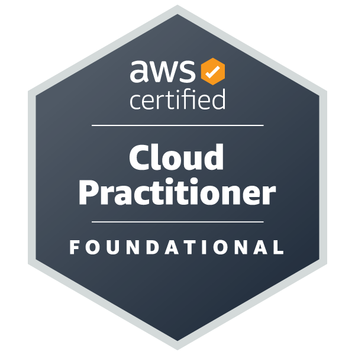
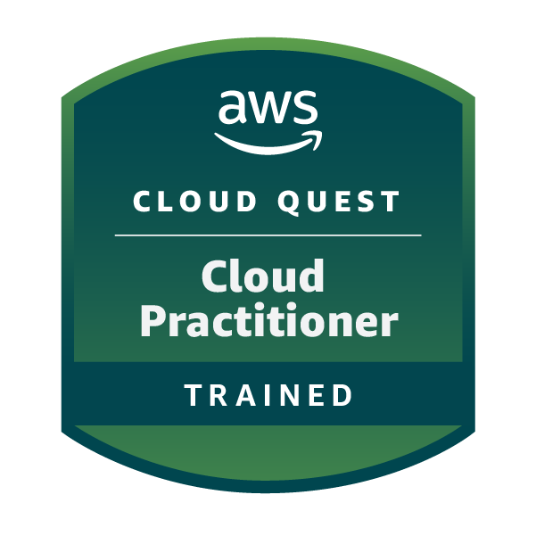

<h1 align="center">Alex Sullca</h1>

  <strong>Systems Engineering Graduate</strong> · Lima, Perú
   
  Interested in Cloud Computing, Networking and IT Infrastructure.

  
  
  
  

---

## 🗂️ Proyectos destacados

### 🌐 NetLab — Laboratorio de Redes Cisco

Laboratorio práctico de diseño e implementación de una infraestructura de red empresarial en Cisco Packet Tracer.

- Segmentación mediante VLAN, enlaces troncales y enrutamiento inter-VLAN.
- Configuración de OSPF, DHCP y DHCP Relay.
- Implementación de NAT/PAT, ACL y seguridad de dispositivos.
- Diagnóstico y resolución de problemas de conectividad.

**Tecnologías:** Cisco Packet Tracer · VLAN · OSPF · DHCP · NAT/PAT · ACL.

[Ver proyecto en GitHub](TU_REPOSITORIO_NETLAB)

### ☁️ Laboratorios AWS

Prácticas de configuración y administración de servicios de infraestructura en AWS.

- **S3:** almacenamiento y administración de objetos.
- **EC2:** configuración de instancias virtuales.
- **VPC:** configuración de redes virtuales.
- **IAM:** administración de usuarios y permisos.

**Tecnologías:** AWS · S3 · EC2 · VPC · IAM.

[Ver proyecto en GitHub](TU_REPOSITORIO_AWS)

---

## 👨🏻‍💻 Sobre mí

Soy egresado de **Ingeniería de Sistemas de la Universidad Nacional Mayor de San Marcos (UNMSM)**, apasionado por la tecnología y la construcción de soluciones que permitan mejorar la infraestructura y los servicios tecnológicos.

Mi enfoque profesional está orientado a **Cloud Computing (AWS), Networking e infraestructura TI**. Me interesa explorar cómo se diseñan, implementan y administran entornos tecnológicos seguros, escalables y eficientes, integrando servicios en la nube y tecnologías de conectividad.

Cuento con la certificación **AWS Certified Cloud Practitioner (CLF-C02)** y conocimientos en tecnologías Cisco. Disfruto enfrentar desafíos técnicos, experimentar mediante laboratorios y transformar los conocimientos adquiridos en soluciones prácticas.

> *Mi objetivo es crecer profesionalmente en Cloud y Networking, participando en proyectos de infraestructura y transformación tecnológica.*

### 🚀 Actualmente enfocado en

- ☁️ **AWS Cloud** — Profundizar en servicios de infraestructura, almacenamiento, redes y seguridad de AWS.
- 🌐 **Networking** — Fortalecer conocimientos de switching, routing, VLAN, OSPF y troubleshooting.
- 🧪 **Laboratorios prácticos** — Desarrollar proyectos de AWS y Cisco Packet Tracer.
- 🖥️ **Infraestructura TI** — Aprender sobre administración, configuración y mantenimiento de servicios tecnológicos.

---

## 🏆 Certificaciones

<blockquote>
  

    
<b>🏅 AWS Cloud</b>

     
    
  

   

  

    
<b>🏅 Desarrollo Web Full Stack - Dev.F</b>

     
    
  

</blockquote>

---

## 🎓 Formación académica

<table>
  <tr>
    <th width="450">Institución</th>
    <th width="300">Formación</th>
    <th width="125">Periodo</th>
  </tr>
  <tr>
    <td>Universidad Nacional Mayor de San Marcos (UNMSM)</td>
    <td>Ingeniería de Sistemas · Egresado</td>
    <td>2024-2</td>
  </tr>
</table>

---

## 🌎 Idiomas

- **Español:** Nativo.
- **Inglés:** Básico (A2) — ICPNA.

---

## 💻 Tecnologías y herramientas

**Cloud Computing**

**Networking**

**Desarrollo y bases de datos**

**Herramientas**

---

### 💬 ¡Conectemos!

Estoy interesado en aprender, compartir conocimientos y participar en proyectos relacionados con Cloud Computing, Networking e infraestructura TI.

**¡Siempre abierto a nuevos desafíos y oportunidades de aprendizaje!**

